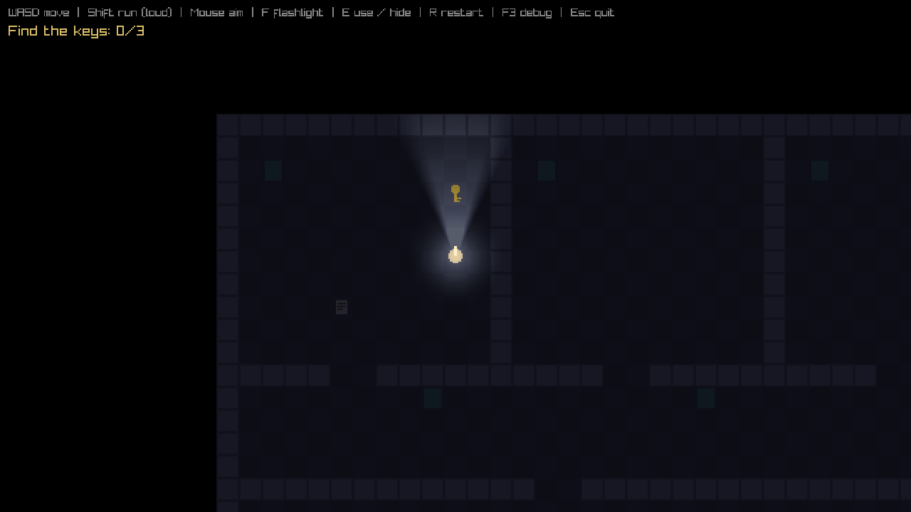

# St. Marrow's

2D top-down stealth horror in C ([raylib](https://www.raylib.com/)). You are an investigator searching an abandoned hospital while one stalker hunts you. Hide, listen, survive.



- **Mode 1** (in progress): 5 chapters, one hospital wing each. More modes later.
- **Lore:** the hospital was made by Mr. A.
- **Platform:** Windows 64-bit.

**Controls:** WASD / arrows move · Shift run (loud) · Mouse aims the flashlight · F flashlight on/off · E use (read a note, unlock the exit, hide in a locker, climb out) · R restart after being caught · F3 debug (shows the stalker's state) · Esc quit

## Chapter 1 goal

Find the 3 keys scattered through the wards, then unlock the exit at the east end of the main corridor (press E at the door). Notes (`n` tiles) can be read with E; the stalker keeps hunting while you read. The story text is placeholder: rewrite it in `assets/notes/mode1_ch1.txt`.

## How the stalker works

- It patrols the points `1`, `2`, `3`... in the map file, then loops.
- **Sees you:** clear line of sight, inside its field of view, within ~190 px if your flashlight is on, ~55 px if it is off. Once it chases, it watches every direction.
- **Hears you:** walking within ~40 px, running within ~120 px, even through walls. Standing still is silent.
- Hears you: it investigates the noise. Sees you: it chases (faster than you walk, slower than you run). Loses you: it searches the last place it saw you, then goes back to patrolling.
- **Hiding:** press E next to a locker to climb in. Inside, you are invisible and silent. If the stalker watched you climb in, it walks over and opens the locker (game over). If it did not see you, it never checks lockers.
- Every number is in `src/config.h`.

## Set up (Windows, one time)

**Option A: MSYS2** (tested from the MSYS2 terminal)

1. Install [MSYS2](https://www.msys2.org/). Open **MSYS2 UCRT64** (not MINGW64 or MSYS) and run:
   `pacman -S --needed mingw-w64-ucrt-x86_64-gcc mingw-w64-ucrt-x86_64-gdb make`
2. In that terminal go to this folder (drive D: is `/d/...`), then run `make` and `./StMarrows.exe`.
3. For VS Code: in `.vscode/tasks.json` set the `PATH` line to `C:\\msys64\\ucrt64\\bin;C:\\msys64\\usr\\bin;${env:PATH}` (use your MSYS2 folder), and fix the gcc and gdb paths in `c_cpp_properties.json` and `launch.json`. Then **Ctrl+Shift+B** builds.

**Option B: w64devkit**

1. Install [VS Code](https://code.visualstudio.com/) and accept the **C/C++** extension it recommends.
2. Download the latest **w64devkit** (`w64devkit-x64-...exe`) from <https://github.com/skeeto/w64devkit/releases> and extract it so `C:\w64devkit\bin\gcc.exe` exists. Use the latest release: the bundled raylib 6.0 needs a recent MinGW (an old one fails with `undefined reference to 'stat64i32'`).
3. Open this folder in VS Code. **Ctrl+Shift+B** builds, **Terminal > Run Task > Run** starts the game, **F5** debugs.

| Command | Result |
|---|---|
| `make` | debug build, `StMarrows.exe` |
| `make release` | optimized, static, no console window, no DLLs needed |
| `make dist` | release build + `dist/StMarrows-v<version>-win64.zip` |

## Layout

```
src/main.c        window + game loop
src/config.h      every tuning number (speeds, ranges, sizes)
src/map.c/.h      tile map: loading, collision, line of sight, drawing
src/path.c/.h     route finding on the tile grid (breadth-first search)
src/player.c/.h   input, movement, noise, hiding
src/stalker.c/.h  the stalker's state machine
src/items.c/.h    keys, notes, the exit door
src/light.c/.h    lights and shadows (walls block light)
assets/maps/      levels as plain text: edit them in VS Code
assets/notes/     the text of the notes you find (plain text)
assets/CREDITS.md every third-party asset: author, license, link
libs/raylib/      raylib 6.0 headers + static lib for MinGW (zlib license)
tools/package.ps1 builds the release zip
VERSION           version used in the zip name
```

Map legend: `#` wall · `.` floor · `L` locker · `P` player start · `S` stalker start · `1`-`9` stalker patrol points (visited in order) · `K` key · `n` note (numbered top to bottom, left to right, matching the notes file) · `X` locked exit door. Lines starting with `;` are comments.

## Architecture

- No engine, no global soup: plain `struct`s (`Map`, `Player`, `Stalker`) passed by pointer. Each module has a `.h` (what it offers) and a `.c` (how).
- Each frame: **update** (input, movement, AI, all scaled by `dt`) then **draw** (world, light mask, scale to window). Keep them separate.
- The game draws at 640x360 and scales up, so pixel art stays crisp at any window size.
- Lighting: each light draws a soft sprite, then black shadow shapes behind every wall edge that faces away from it. The result is added to the darkness mask, which is multiplied over the world.
- Levels are text files. One wing = one chapter map.
- Assets: CC0 only, logged in `assets/CREDITS.md`.

## Milestones

- [x] **M0** Toolchain set up, `StMarrows.exe` opens
- [x] **M1** Map, player, collision, camera
- [x] **M2** Darkness and flashlight
- [x] **M3** Stalker: patrol, sight, hearing, chase, search, game over
- [x] **M3b** Walls and lockers block the flashlight (shadows)
- [x] **M4** Hide in lockers (safe unless the stalker saw you climb in)
- [x] **M5** Keys, locked exit, notes, objective (locked room doors can come later)
- [ ] **M6** Chapter 1 complete: menu, pause, save, audio, CC0 art pass. **Release v0.1.0**
- [ ] **M7-M10** Chapters 2-5, one new mechanic each
- [ ] **M11** Polish: settings, controller, performance. **Release v1.0 (Mode 1 complete)**

## Publish on GitHub

1. On github.com create an empty repo (no README or license; this folder has them).
2. In this folder:
   ```
   git init
   git add .
   git commit -m "St. Marrow's"
   git branch -M main
   git remote add origin https://github.com/<you>/<repo>.git
   git push -u origin main
   ```
3. Release: edit `VERSION`, run `make dist`, then on GitHub go to **Releases > Draft a new release**, create tag `v0.1.0`, attach `dist/StMarrows-v0.1.0-win64.zip`, publish.

Players download that zip from the **Releases** page, extract it, and double-click `StMarrows.exe`. The green **Code > Download ZIP** button only gives source code, not the game. Windows may warn about an unsigned EXE; `HOW_TO_PLAY.txt` in the zip explains the click-through.

## Licenses

Code: MIT (put your name in `LICENSE`). raylib: zlib (`libs/raylib/LICENSE`). Art and audio keep their own licenses (`assets/CREDITS.md`).
